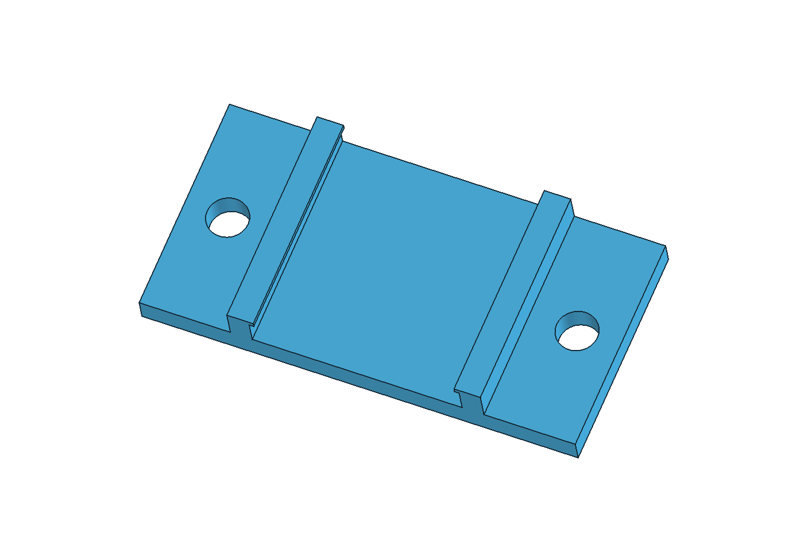
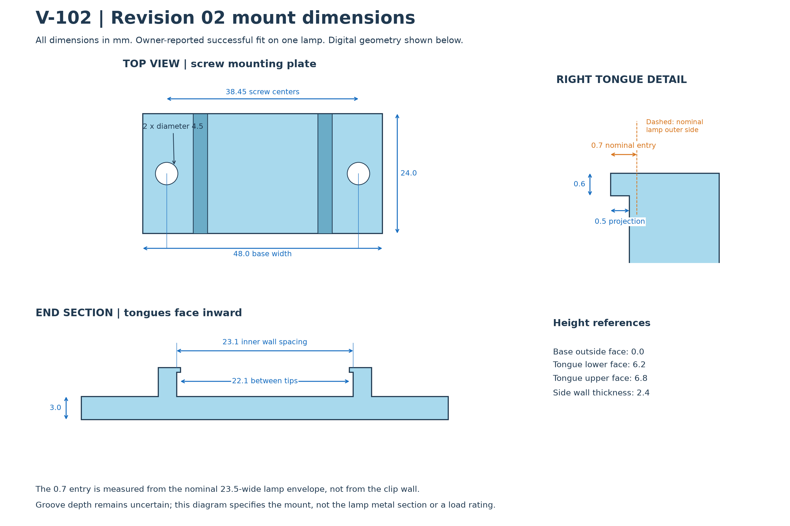
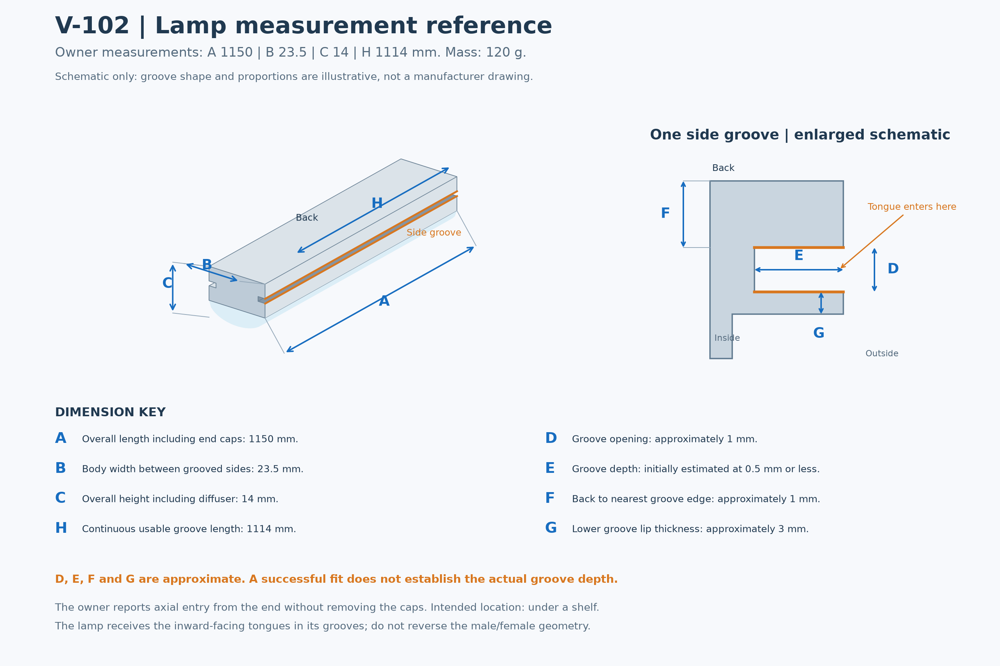
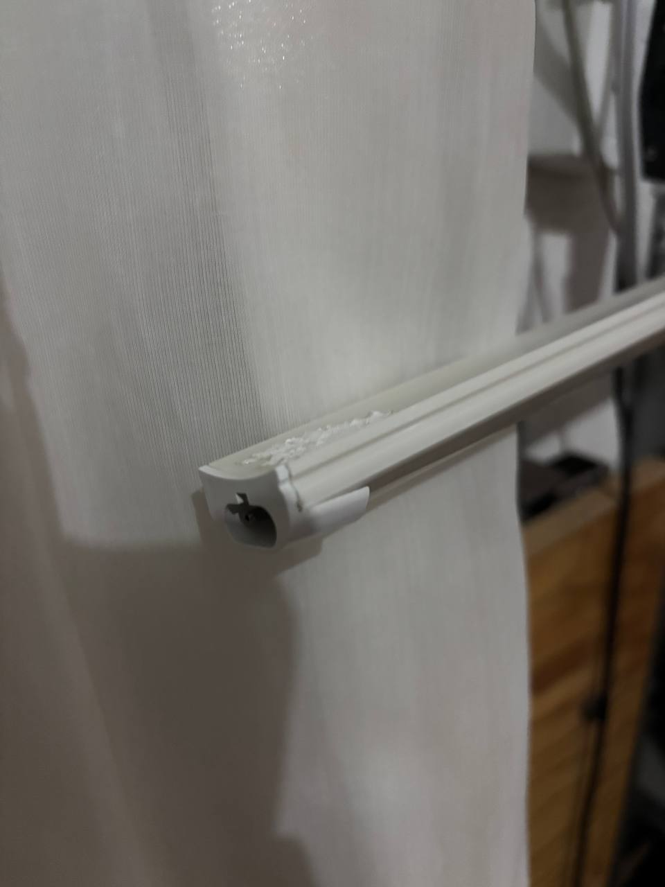

# V-102 LED Batten Shelf Mount

A 3D-printable, screw-mounted clip for a narrow V-102 LED batten with longitudinal side grooves. Two inward-facing tongues slide into the lamp's grooves from an end; the mounting wings screw to the underside of a shelf.

**Revision 02 fits the project owner's lamp, as confirmed by the owner.** This is a fit report for one specimen, not a universal V-102 compatibility claim or a load/temperature rating.



## Download

| File | Purpose |
| --- | --- |
| [Confirmed-fit STL](stl/v102-mount-r02-confirmed-fit.stl) | Start here to print revision 02. Preserved from the file delivered before the successful fit report. |
| [Editable FreeCAD project](cad/v102-mount.FCStd) | Native solids, an English dimension spreadsheet, and expressions. No MCP required to edit. |
| [STEP model](cad/v102-mount.step) | Solid geometry for other CAD software. |
| [Parametric OpenSCAD source](cad/v102-mount.scad) | A second editable representation of the same nominal profile. |
| [Dimension drawing](images/mount-dimensions.png) | Top view, end section, tongue detail, and screw dimensions. |
| [Lamp measurement map](images/lamp-measurement-map.png) | Original measurement key, recreated in English. |
| [Downloadable release](https://github.com/neura-neura/v102-led-batten-mount/releases/latest) | ZIP bundle and individual printable/editable files. |

STL units are millimeters. Print at **100% scale**. The provided STL is already rotated onto its end section: its bounding dimensions are **48 × 6.8 × 24 mm**, with the 24 mm lamp-axis length vertical in the slicer. The FreeCAD/STEP model uses the design orientation, **48 × 24 × 6.8 mm**. These are rotations of the same geometry.

## How the mount works

The lamp has the **female side grooves**. The clip has the **male tongues**, pointing inward. Slide the lamp and clip together along the lamp axis rather than forcing the clip over the body as a snap latch. Screw holes remain outside the lamp so the mounting hardware is accessible.

The reference lamp's end caps permit entry from the end without disassembly. Confirm that your own lamp has the same clearance.



## Revision 02 dimensions

All dimensions below are in millimeters.

| Parameter | Value | Meaning |
| --- | ---: | --- |
| Lamp body width, reference | 23.5 | Owner-measured nominal envelope |
| Inner wall spacing | 23.1 | Clear spacing between clip side walls |
| Tongue entry per side | 0.7 | Nominal entry relative to the lamp envelope |
| Tongue projection from clip wall | 0.5 | Length projecting inward beyond the wall |
| Tip-to-tip spacing | 22.1 | Distance between the two tongue tips |
| Tongue thickness | 0.6 | Thickness inside the groove opening |
| Tongue lower / upper face height | 6.2 / 6.8 | Measured from the base's outside face |
| Side wall thickness | 2.4 | Each side |
| Base width × length × thickness | 48 × 24 × 3 | Mounting plate |
| Screw clearance holes | 2 × Ø4.5 | Unthreaded |
| Screw center spacing | 38.45 | Center to center |

**Entry and projection are different measurements.** Entry is measured from the nominal lamp side, while projection is measured from the clip's inner wall. The nominal 23.1 mm wall spacing is 0.4 mm narrower than the 23.5 mm lamp reference, so this revision has 0.2 mm nominal interference per side. The successful fit report does not tell us how much actual plastic deflection, lamp shape variation, or print tolerance accounts for that interference.

## Edit it yourself

Open [the FreeCAD file](cad/v102-mount.FCStd), then double-click **DIMENSIONS - double-click to edit** in the model tree. Change a green value in column B and press Enter. Blue cells are calculated values.

| Cell | Setting | Current value |
| --- | --- | ---: |
| B5 | Inner wall spacing | 23.1 |
| B6 | Tongue entry per side | 0.7 |
| B7 | Tongue thickness | 0.6 |

For a first exercise, change B6 from `0.7` to `0.6`, view the shortened tongues, then restore `0.7`. See the [complete beginner editing guide](docs/freecad-editing.md) for all cells, formulas, saving, and STL export.

## Printing and mounting

The owner's successful print settings and material were **not recorded**. Reuse your own proven settings if reproducing that print. Otherwise start with one fit sample and inspect the thin 0.6 mm tongues in the slicer's layer preview; do not assume the slicer preserves them automatically. The supplied end-on orientation avoids a horizontal tongue overhang, but creates a narrow footprint, so bed adhesion matters.

Test with the lamp disconnected and supported. Both tongues must engage the grooves; do not pull the clip into place with the mounting screws. Use screws appropriate to the shelf material and thickness, with flat bearing heads and suitable washers. No screw length is prescribed because the shelf was not measured. Screws fasten to the shelf, never into the lamp casing.

See [printing and installation](docs/printing-and-installation.md) for proposed clip positions, axial retention, and the optional untested stop.

## Reference lamp and compatibility

| ID | Measurement | Owner-supplied value | Confidence |
| --- | --- | ---: | --- |
| A | Overall length | 1150 mm | Owner measured |
| B | Body width | 23.5 mm | Owner measured |
| C | Overall height | 14 mm | Owner measured |
| D | Groove opening | ~1 mm | Approximate |
| E | Groove depth | Initially estimated ≤0.5 mm | Unverified |
| F | Back to nearest groove edge | ~1 mm | Approximate |
| G | Lower groove lip thickness | ~3 mm | Approximate |
| H | Usable groove length | 1114 mm | Owner measured |
| — | Mass | 120 g, approximately 4.2 oz | Owner supplied |



The lamp is marked **V-102, 127 V**. The label code was read approximately as `PVCT8FSR-018CL-01`; its exact reading and manufacturer were not established. No manufacturer section drawing or third-party printable clip was confirmed compatible during the original research. This design was developed from the owner's photograph, measurements, and fit feedback.

The initial groove-depth estimate of ≤0.5 mm is smaller than the successful revision's nominal 0.7 mm entry. We preserve both records rather than claiming a newly measured groove depth. The schematic is not a reconstruction of the metal folds. Other lamps using the same model marking may differ.

<details>
<summary>Owner's side-groove reference photograph</summary>



This reference photo predates the final mount. It documents the lamp, not an installed or tested final assembly.

</details>

## Versions and verification

| Version | Inner wall spacing | Nominal entry | Status |
| --- | ---: | ---: | --- |
| R01 / 0.2 | 24.1 | 0.2 per side | Owner reported that it fitted, but was loose |
| R01 / 0.3 and 0.4 | 24.1 | 0.3 / 0.4 per side | Archived, physically untested |
| **R02** | **23.1** | **0.7 per side** | **Owner confirmed successful fit** |
| Optional axial stop | — | — | Separate experimental part; untested |

The 1 mm total closure in R02 moved each arm inward by 0.5 mm. Relative to the lamp envelope, entry therefore increased from 0.2 to 0.7 mm per side; this increase was applied once. The standalone tongue projection remains 0.5 mm. Earlier designs with the wrong groove interpretation are not included.

The FreeCAD model was checked for one valid solid and parameter-driven rebuilding. The English model and regenerated STL were compared with the delivered geometry. Mesh and file integrity results are in [verification](verification/). None of these digital checks establish physical load capacity, fatigue life, long-term creep, or thermal performance.

## Repository contents

- `cad/`: English FreeCAD project, STEP, and OpenSCAD sources.
- `stl/`: confirmed-fit STL, regenerated equivalent, archived variants, experimental axial stop.
- `images/`: CAD render, dimension diagrams, reference lamp photograph.
- `data/`: dimensions and measurement tables in JSON and CSV.
- `docs/`: editing, mounting, and revision notes.
- `tools/`: FreeCAD rebuilding macro, diagram scripts, and mesh verification script.
- `verification/`: machine-readable checks and file hashes.

## Rebuild

For the editable model, open FreeCAD and run `tools/build_freecad.FCMacro` through **Macro → Macros**. The macro writes CAD files, a regenerated STL, a render, and a solid report into this repository. It does not overwrite the preserved confirmed-fit STL. It is a full rebuild using the nominal R02 defaults, not an exporter of changes you made in the spreadsheet. FreeCAD 1.1.4 was used for the included files.

For diagrams and mesh checks, install the dependencies in `tools/requirements.txt`, then run:

```sh
python tools/draw_lamp_measurements.py
python tools/draw_mount_dimensions.py
python tools/verify_meshes.py
```

The FreeCAD file is editable without Python packages, an account, a plugin, or an MCP server. The OpenSCAD source is provided as an alternate representation; the published STL was produced through FreeCAD, and OpenSCAD compilation was not part of validation.

## License

[MIT](LICENSE). An independent community design; no affiliation with the lamp manufacturer.
